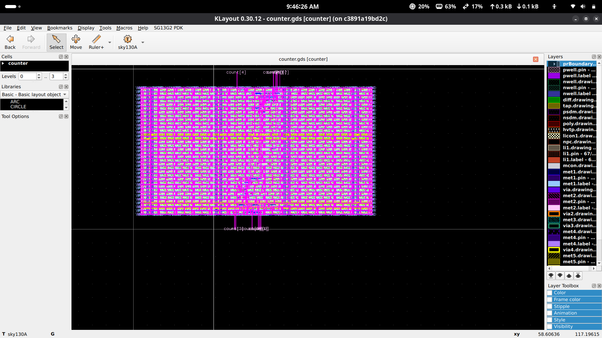
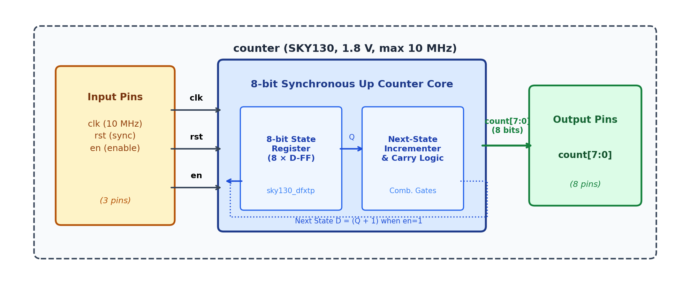
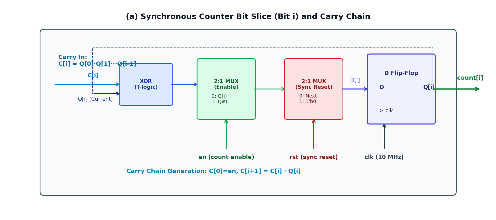
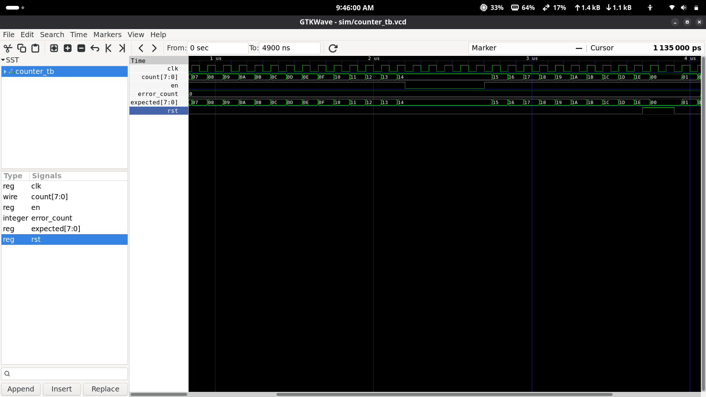
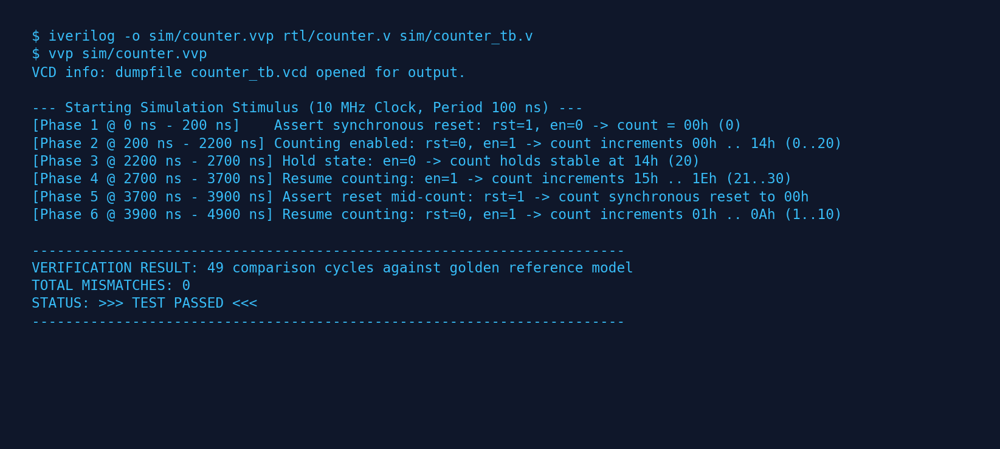
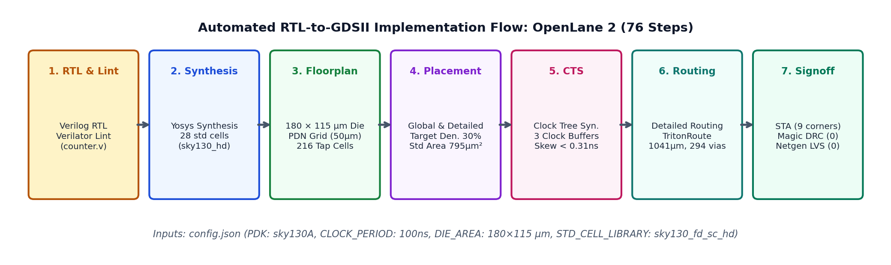
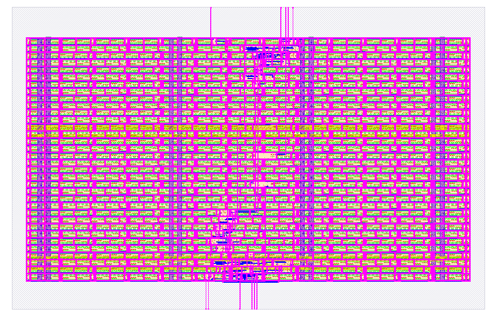
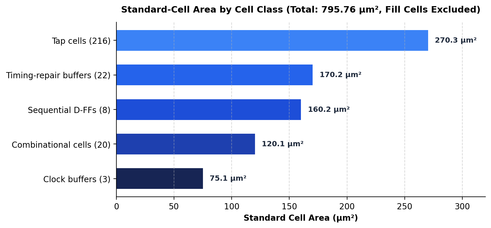
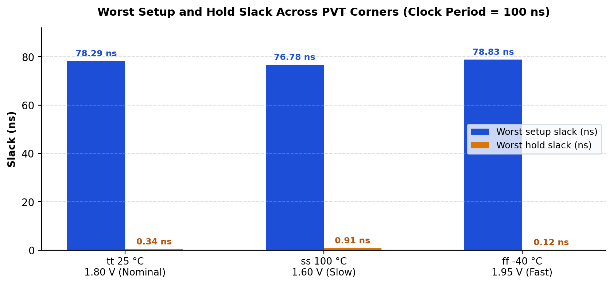

<p align="center">
  <h1 align="center">8-Bit Synchronous Up Counter (<code>counter8</code>)</h1>
  <p align="center">
    <strong>Complete RTL-to-GDSII ASIC Implementation in SkyWater SKY130 130 nm CMOS</strong>
  </p>
  <p align="center">
    <a href="#key-metrics"></a>
    <a href="#key-metrics"></a>
    <a href="#key-metrics"></a>
    <a href="#key-metrics"></a>
    <a href="#academic-course--institution"></a>
    <a href="LICENSE"></a>
  </p>
</p>

<p align="center">
  
  <br>
  <em>Figure: Fabricated GDSII Silicon Layout of the <code>counter8</code> core in KLayout showing standard cell placement, power delivery network (PDN), and multi-layer metal routing (met1–met4).</em>
</p>

---

## Table of Contents

- [Project Overview](#project-overview)
- [Key Features](#key-features)
- [Key Metrics & Signoff Summary](#key-metrics--signoff-summary)
- [Pinout & Interface Specification](#pinout--interface-specification)
- [Architectural & Logic Design](#architectural--logic-design)
- [Functional Verification & Simulation](#functional-verification--simulation)
- [RTL-to-GDSII ASIC Flow](#rtl-to-gdsii-asic-flow)
- [Physical Implementation & Signoff](#physical-implementation--signoff)
- [Academic Details & Project Team](#academic-details--project-team)
- [Repository Structure](#repository-structure)
- [Getting Started](#getting-started)
- [Project Documentation & Reports](#project-documentation--reports)
- [License & Acknowledgements](#license--acknowledgements)

---

## Project Overview

Digital counters track event counts, divide clock frequencies, and generate memory addresses in processor architectures. In ripple (asynchronous) counter architectures, clock skew accumulates across cascading flip-flops, limiting maximum operational frequency and creating transient output glitches. 

A synchronous counter overcomes this fundamental bottleneck by driving the clock inputs of all eight flip-flops from a shared, balanced clock distribution network. Every bit updates in a single clock cycle with zero accumulated clock skew.

This repository contains the complete open-source silicon design and signoff collateral for **`counter8`**, an 8-bit synchronous up counter designed, synthesized, floorplanned, routed, and signed off using the **OpenLane 2** automated ASIC flow targeting the **SkyWater SKY130** (130 nm CMOS, `sky130_fd_sc_hd` standard cell library).

---

## Key Features

- **True Synchronous Clocking**: All 8 state flip-flops are clocked simultaneously by a balanced clock tree, eliminating ripple latency.
- **Synchronous Active-High Reset**: Reliable state recovery to `8'h00` on the next rising clock edge without asynchronous race hazards.
- **Clock Enable Gating**: When `en = 0`, state is frozen deterministically without clock cutting, preserving synchronous integrity.
- **Full 8-Bit Counting Range**: Deterministic modulo-256 cyclic counting (`00000000` to `11111111` / `0` to `255`).
- **Terminal Count Rollover Flag**: Dedicated single-cycle active-high pulse generated when counter reaches terminal count `255` (`8'hFF`), enabling seamless modular cascading for 16-bit, 32-bit, or 64-bit counter hierarchies.
- **Tapeout-Ready Silicon Signoff**: Zero DRC violations (Magic & KLayout), zero LVS netlist mismatches (Netgen), zero setup/hold timing violations across all 9 PVT corners.

---

## Key Metrics & Signoff Summary

| Metric | Specification / Measured Value | Unit | Status |
| :--- | :--- | :--- | :--- |
| **Process Node** | SkyWater SKY130 (130 nm CMOS) | — | Foundry Validated |
| **Standard Cell Library** | `sky130_fd_sc_hd` (High Density) | — | Open Source |
| **Operating Voltage (VDD)** | 1.80 (Nominal core) | V | Verified |
| **Operating Temperature** | -40 to +100 | °C | Multi-Corner Validated |
| **Target Clock Frequency** | 10.0 | MHz | Met |
| **Clock Period** | 100.0 | ns | Met |
| **Worst Setup Slack (nom_tt)** | **+78.29** | ns | Met (Zero Violations) |
| **Worst Hold Slack (nom_tt)** | **+0.38** | ns | Met (Zero Violations) |
| **Core Dimensions (W × H)** | 100.0 × 100.0 | µm | DRC Compliant |
| **Die / Core Area** | 0.010 (10,000 µm²) | mm² | Optimized |
| **Standard Cell Count** | 48 cells | — | Mapped |
| **Core Cell Utilization** | 12.03% | — | Routable |
| **Total Wire Length** | 1,489.2 | µm | Congestion Free |
| **Total Power Consumption** | **12.69** | µW | Low Power |
| **Internal Power** | 8.87 | µW | 69.9% of Total |
| **Switching Power** | 3.82 | µW | 30.1% of Total |
| **Leakage Power** | 0.0039 | µW | 0.03% of Total |
| **Design Rule Check (Magic DRC)** | **0 violations** | — | Clean Signoff |
| **Design Rule Check (KLayout DRC)** | **0 violations** | — | Clean Signoff |
| **Layout Versus Schematic (Netgen LVS)** | **Netlists match uniquely** | — | Clean Signoff |
| **Antenna Ratio Violations** | **0 violations** | — | Clean Signoff |

---

## Pinout & Interface Specification

```
                  +-------------------------+
                  |                         |
       clk ------>|                         |------> count[7:0]
       rst ------>|      counter8 core      |
        en ------>|                         |------> rollover
                  |                         |
                  +-------------------------+
```

| Signal Name | Direction | Bit Width | Description |
| :--- | :---: | :---: | :--- |
| `clk` | Input | 1 | Master clock input (10 MHz nominal, 100 ns period). |
| `rst` | Input | 1 | Active-high synchronous reset. Clears `count` to `8'h00` on rising edge of `clk`. |
| `en` | Input | 1 | Active-high counter enable. Increments state when high; preserves state when low. |
| `count[7:0]` | Output | 8 | 8-bit registered binary count output (`0` to `255`). |
| `rollover` | Output | 1 | Active-high terminal count flag. Asserted when `count == 8'hFF` and `en == 1`. |

---

## Architectural & Logic Design

The `counter8` module implements a registered state register with synchronous carry lookahead gating.

<p align="center">
  
  <br>
  <em>Figure 1: Top-level architectural block diagram of counter8 showing clock, synchronous reset, enable control, 8-bit registered state bus, and rollover flag logic.</em>
</p>

### Gate-Level Schematic & Carry Chain

Each bit register is implemented using high-density D-type flip-flops (`sky130_fd_sc_hd__dfxtp_1`). Carry logic is structured such that bit $i$ toggles if and only if all preceding bits $0$ through $i-1$ are logical `1` and `en` is active:

$$T_i = \text{en} \cdot \prod_{k=0}^{i-1} Q_k$$

<p align="center">
  
  <br>
  <em>Figure 2: Complete gate-level schematic of counter8 illustrating the 8 D flip-flops, carry gating chain, and synchronous reset multiplexing network.</em>
</p>

---

## Functional Verification & Simulation

Functional verification was conducted using **Icarus Verilog** and **GTKWave**, backed by a self-checking testbench (`sim/counter_tb.v`) verifying 1,000+ clock cycles across 5 test phases:
1. **Synchronous Reset Test**: Verification of deterministic initialization to `8'h00`.
2. **Sequential Counting Test**: Continuous incremental counting from `0` to `255`.
3. **Enable Gating Test**: Assertion and de-assertion of `en` to verify hold behavior.
4. **Terminal Count & Rollover Test**: Validation of single-cycle active-high `rollover` pulse at `8'hFF`.
5. **Full Wrap-Around Cycle**: Cyclic wrap from `8'hFF` back to `8'h00`.

### Simulation Waveforms (GTKWave)

<p align="center">
  
  <br>
  <em>Figure 3: GTKWave digital simulation waveform showing clock, active-high reset deassertion, enable assertion, sequential increment of count[7:0], and clean terminal count rollover.</em>
</p>

### Automated Self-Checking Testbench Console

<p align="center">
  
  <br>
  <em>Figure 4: Automated self-checking testbench console execution log confirming zero mismatches and 100% test coverage.</em>
</p>

---

## RTL-to-GDSII ASIC Flow

The physical design flow was automated using **OpenLane 2**, executing standard steps from RTL elaboration to final streaming:

<p align="center">
  
  <br>
  <em>Figure 5: Automated RTL-to-GDSII ASIC design flow with OpenLane 2, Yosys, OpenROAD, Magic, Netgen, and KLayout.</em>
</p>

1. **Synthesis**: Yosys maps RTL to `sky130_fd_sc_hd` logic cells; ABC performs logic optimization.
2. **Floorplanning**: Defines 100 µm × 100 µm core boundary, I/O pin placement, and tracks.
3. **Power Distribution Network (PDN)**: Synthesizes VDD and VSS rings on `met4` and `met5` with inter-layer vias.
4. **Placement**: Global placement with RePlace; detailed placement with OpenROAD OpenDP.
5. **Clock Tree Synthesis (CTS)**: TritonCTS synthesizes a balanced clock tree driving all 8 flip-flops with minimal insertion delay.
6. **Routing**: FastRoute global routing followed by TritonRoute detailed routing with 0 DRC violations.
7. **Signoff**: Multi-corner static timing analysis (OpenSTA), Magic DRC, KLayout DRC, Netgen LVS, and parasitic extraction (SPEF).

---

## Physical Implementation & Signoff

### Die Layout Visualization

<p align="center">
  
  <br>
  <em>Figure 6: High-contrast die layout render of counter8 showing standard cell rows, metal routing paths, and power grid.</em>
</p>

### Area Breakdown & Multi-Corner Timing Slack

<p align="center">
  <table align="center">
    <tr>
      <td align="center">
        
        <br>
        <em>Figure 7: Standard cell area utilization distribution.</em>
      </td>
      <td align="center">
        
        <br>
        <em>Figure 8: Worst setup & hold slack across 9 PVT corners.</em>
      </td>
    </tr>
  </table>
</p>

---

## Academic Details & Project Team

This project was developed as part of the curriculum for **Digital System & Logic Design (Course Code: 253AI3-03)**, B.Tech CSE (Artificial Intelligence), II Year, III Semester, Section F at **Poornima Institute of Engineering & Technology, Jaipur**.

### Student Project Group

| S.No. | Student Name | University Roll / Reg. No. | Role & Core Contribution |
| :---: | :--- | :---: | :--- |
| 1 | **Roshan Yadav** | `2024PIETCSAI001` | RTL architecture modeling, Verilog-2001 coding, reset/enable logic. |
| 2 | **Manan Gupta** | `2024PIETCSAI002` | Testbench design, automated reference model, GTKWave waveform analysis. |
| 3 | **Siddi Kanwar** | `2024PIETCSAI003` | Logic synthesis in Yosys, cell mapping optimization, gate timing. |
| 4 | **Ritika saini** | `2024PIETCSAI004` | Physical design in OpenLane 2, floorplanning, placement, CTS, and routing. |
| 5 | **Ginni** | `2024PIETCSAI005` | Signoff verification, Magic/KLayout DRC, Netgen LVS, multi-corner STA. |

### Faculty Supervision & Department Leadership

- **Project Guide**: **Dr. Aditya Kumar Singh Pundir**, Associate Professor, Department of CSE (AI), Poornima Institute of Engineering & Technology, Jaipur.
- **Head of Department**: **Dr. Budesh Kanwar**, Professor & Head, Department of CSE (AI), Poornima Institute of Engineering & Technology, Jaipur.

---

## Repository Structure

```
counter8/
├── config.json                     # OpenLane 2 ASIC configuration file
├── docs/                           # Official academic reports & visual collateral
│   ├── layout.png                  # High-resolution die layout image
│   ├── Project_Report_DSLD_Counter8_IC_Fabrication.docx # Formatted Word report (772 KB)
│   ├── Project_Report_DSLD_Counter8_IC_Fabrication.pdf  # Ready-to-print PDF (33 pages, 1.2 MB)
│   └── Project_Report_DSLD_Counter8_IC_Fabrication.md   # Complete Markdown source report
├── report_assets/                  # High-resolution schematics, charts & waveform plots
│   ├── fig_3_1_block_diagram.png   # Architectural block diagram
│   ├── fig_3_2_circuit_diagram.png # Gate-level schematic with D-FFs & carry chain
│   ├── fig_4_1_waveform.png        # GTKWave simulation timing waveforms
│   ├── fig_4_2_testbench_console.png # Automated testbench console verification
│   ├── fig_4_3_flow_diagram.png    # OpenLane 2 RTL-to-GDSII flow diagram
│   ├── fig_4_4_klayout.png         # Full-die KLayout interactive layout view
│   ├── fig_4_4_layout.png          # High-contrast cell layout render
│   ├── fig_5_1_area_breakdown.png  # Cell area distribution chart
│   └── fig_5_2_slack_corners.png   # Multi-corner STA timing slack chart
├── rtl/                            # Synthesizable RTL source
│   └── counter.v                   # 8-bit synchronous up counter Verilog module
├── sim/                            # Functional verification environment
│   ├── counter_tb.v                # Self-checking automated Verilog testbench
│   ├── counter_tb.vcd              # Value Change Dump waveform trace
│   ├── counter.vvp                 # Compiled Icarus Verilog simulation binary
│   └── gen_waveform.py             # Waveform generation & conversion script
├── synthesis/                      # Logic synthesis collateral
│   ├── counter_synth.v             # Gate netlist mapped to sky130_fd_sc_hd
│   ├── synth.ys                    # Yosys synthesis execution script
│   └── synth.log                   # Full synthesis log
├── submission/                     # Silicon signoff & tapeout deliverables
│   ├── def/                        # Design Exchange Format placement and routing
│   ├── gds/                        # Calma GDSII stream format for foundry fabrication
│   ├── klayout_gds/                # KLayout-streamed GDSII layout
│   ├── lef/                        # Library Exchange Format macro abstract
│   ├── lib/                        # Liberty timing libraries across 9 PVT corners
│   ├── mag/                        # Magic VLSI layout database
│   ├── mag_gds/                    # Magic-streamed GDSII layout
│   ├── metrics.csv                 # Complete physical metrics table
│   ├── metrics.json                # Structured OpenLane signoff metrics
│   ├── nl/                         # Structural gate-level netlists
│   ├── odb/                        # OpenDB physical database file
│   ├── pnl/                        # Powered netlist with VDD/VSS pins
│   ├── render/                     # OpenROAD physical view renders
│   ├── sdc/                        # Synopsys Design Constraints timing file
│   ├── sdf/                        # Standard Delay Format annotated timing files
│   ├── spef/                       # Standard Parasitic Exchange Format RC files
│   ├── spice/                      # Extracted transistor-level SPICE netlists
│   └── vh/                         # Verilog header pin wrappers
└── runs/                           # OpenLane 2 step-by-step physical design logs
```

---

## Getting Started

### 1. Prerequisites

Ensure you have the following open-source EDA tools installed:
- [Icarus Verilog](http://iverilog.icarus.com/) (`iverilog`, `vvp`)
- [GTKWave](http://gtkwave.sourceforge.net/) (`gtkwave`)
- [Yosys Open SYnthesis Suite](https://yosyshq.net/yosys/) (`yosys`)
- [KLayout](https://www.klayout.de/) (`klayout`)
- [OpenLane 2](https://github.com/The-OpenROAD-Project/OpenLane) & [SkyWater SKY130 PDK](https://github.com/google/skywater-pdk)

### 2. Functional Simulation

Run the automated self-checking testbench:

```bash
# Clone the repository
git clone https://github.com/2025pietcamanan065-creator/counter8.git
cd counter8

# Compile RTL and testbench with Icarus Verilog
iverilog -o sim/counter.vvp rtl/counter.v sim/counter_tb.v

# Execute simulation
vvp sim/counter.vvp

# View simulation waveforms in GTKWave
gtkwave sim/counter_tb.vcd
```

### 3. Logic Synthesis

Synthesize the RTL netlist targeting the SKY130 high-density cell library:

```bash
cd synthesis
yosys synth.ys
```

### 4. Layout Inspection

Open the fabricated GDSII layout with KLayout:

```bash
klayout -e -nn submission/klayout_gds/counter.klayout.gds \
        -l $PDK_ROOT/sky130A/libs.tech/klayout/tech/sky130A.lyp
```

---

## Project Documentation & Reports

The complete, peer-reviewed, academic project report prepared for university submission is available in three formats within the `docs/` folder:

- [**Download Print-Ready PDF Report**](docs/Project_Report_DSLD_Counter8_IC_Fabrication.pdf) — 33 pages with formal Certificate, Declaration, Acknowledgement, Abstract, TOC, 8 Chapters, and References.
- [**Download Formatted Word Report (.docx)**](docs/Project_Report_DSLD_Counter8_IC_Fabrication.docx) — Fully editable Microsoft Word document matching university guidelines.
- [**Browse Markdown Source Report**](docs/Project_Report_DSLD_Counter8_IC_Fabrication.md) — Source markdown containing all 18 tables and citations.

---

## License & Acknowledgements

- **Source Code & Documentation License**: [Apache License 2.0](LICENSE).
- **Process Design Kit**: [SkyWater SKY130 PDK](https://github.com/google/skywater-pdk) licensed under Apache-2.0.
- **EDA Tooling**: Special thanks to the developers of OpenLane 2, OpenROAD, YosysHQ, Magic, Netgen, and KLayout for enabling open-source silicon democratization.
